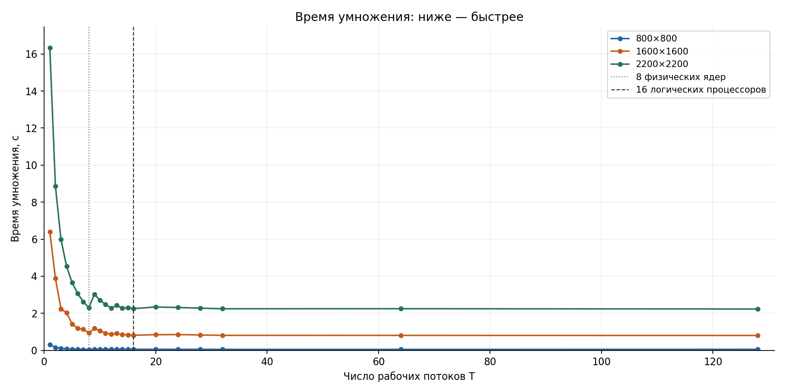
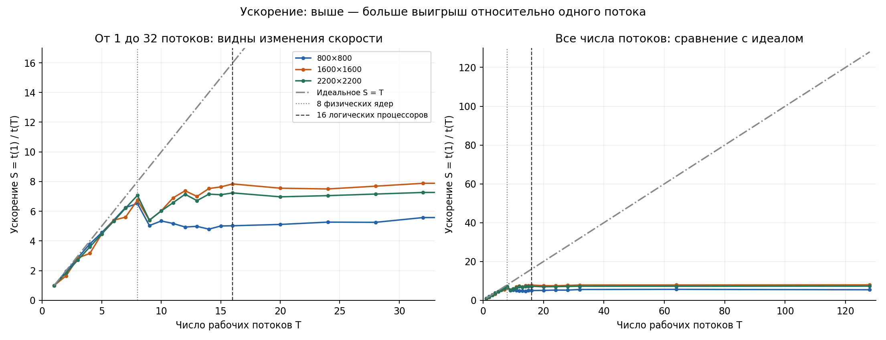
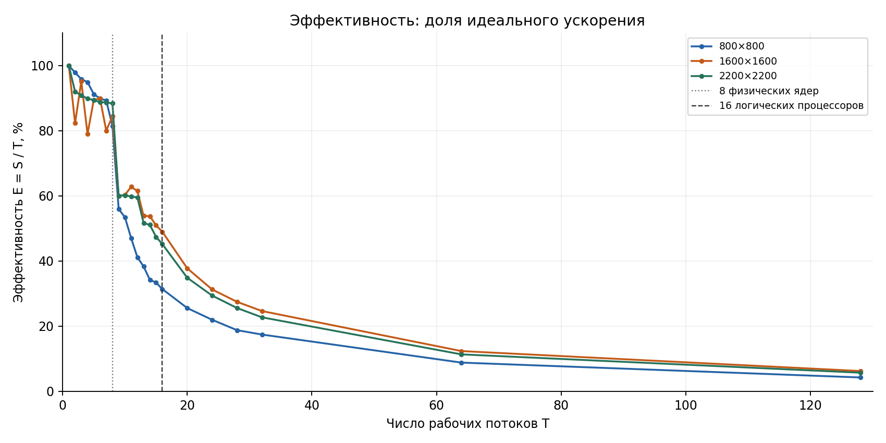
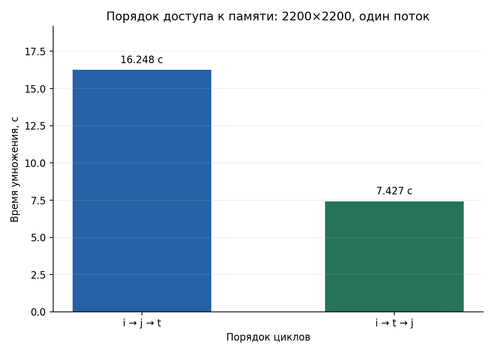

# Отчет по лабораторной работе № 2

## 1. Титульная часть

**Тема:** многопоточное умножение матриц.  
**Выполнил:** Антончик Олег Евгеньевич.  
**Группа:** ИТ-1.  
**Уровень:** требования на оценку 3, с юнит-тестами.

Цель работы — вручную распределить вычисление матричного произведения между
потоками ОС, синхронизировать общий счетчик прогресса и экспериментально
исследовать зависимость времени от числа потоков.

## 2. Среда выполнения

1. **Процессор и кэш:** AMD Ryzen 7 5700X, 8 физических ядер одного типа,
   16 логических процессоров, кэш L3 — 32 МиБ.

2. **Оперативная память:** объем, видимый ОС, — 16 640 872 448 байт,
   примерно 15,50 ГиБ.

3. **Операционная система:** Ubuntu 24.04.5 LTS, x86-64,
   ядро Linux 7.0.0-42-generic.

4. **Язык и сборка:** C++20, GCC 13.3.0, CMake 3.28.3, конфигурация Release.
   Флаги: `-O2 -DNDEBUG -std=c++20 -Wall -Wextra -Wpedantic`.

5. **Основная ОС:** замеры выполнены на основной системе, вне виртуальной
   машины. Команда `systemd-detect-virt` вернула `none`.

## 3. Описание реализации

Матрица A размером n×m и матрица B размером m×k — исходные данные.
Матрица C размером n×k — результат их умножения. T — число вычисляющих потоков.

1. **Хранение матриц и порядок циклов.** Класс `Matrix` хранит размеры и
   одномерный `std::vector<int64_t>`. Индекс элемента — `i * cols + j`.
   Здесь i — номер строки, j — номер столбца, t — индекс слагаемого при
   вычислении элемента результата. Умножение написано вручную с порядком
   циклов `i → j → t`: сначала выбирается строка результата, затем столбец,
   затем складываются произведения элементов строки матрицы A и столбца матрицы B.
   Исходные значения от 0 до 9 генерируются `std::mt19937` с начальным
   значением 42. До вычислений проверяется, что верхняя граница суммы всех
   элементов результата `81 * n * m * k` помещается в `int64_t`.

2. **Распределение работы между потоками.** Вручную создаются T объектов
   `std::thread`. Каждый получает непрерывный участок из `n / T` строк,
   а первые `n % T` потоков — еще по одной. Например, при n=10 и T=3
   потоки считают строки 0–3, 4–6 и 7–9 соответственно.
   При T>n первые n потоков получают по одной строке, остальные не получают
   строк и сразу завершаются. Деление одной строки между потоками не используется.

3. **Счетчик прогресса и его защита.** После полной записи строки поток
   увеличивает общий счетчик типа `std::atomic<size_t>` и уведомляет главный поток:

   ```cpp
   completed_rows.fetch_add(1);
   completed_rows.notify_one();
   ```

   Главный поток ожидает изменения счетчика через `wait`, читает его через
   `load` и выводит изменившийся процент не чаще раза в 250 мс.
   После завершения всех вычисляющих потоков печатается ровно одно конечное 100%.
   Без атомарности два потока могли бы прочитать одинаковое старое значение
   и потерять одно увеличение. В C++ такой доступ также создает гонку данных
   с неопределенным поведением.

4. **Сборка итоговой матрицы.** Память под полную матрицу результата C
   выделяется до запуска вычисляющих потоков. Каждый поток записывает элементы
   непосредственно в свои строки общей матрицы C. Участки не пересекаются,
   исходные матрицы A и B только читаются, поэтому мьютекс для матрицы
   результата не нужен. Главный поток вызывает `join()` для всех вычисляющих
   потоков и затем использует готовую матрицу C. После остановки таймера
   вычисляется контрольная сумма — сумма всех ее элементов.
   Целиком печатаются только матрицы, у которых обе стороны не больше 10.

5. **Проверка корректности.** Юнит-тесты сравнивают каждый элемент результата
   с известным ответом или последовательным вычислением, в том числе при
   остатке строк и T>n. Дополнительная проверка независимо пересчитывает
   маленькие произведения по выводу программы. В серии измерений проверяются
   совпадение контрольных сумм для каждого размера и завершение прогресса на 100%.
   Одинаковая сумма дополняет поэлементные тесты, но не заменяет их.

## 4. Методика измерений

### Выбор размеров и числа потоков

Для исследования выбраны три размера квадратных матриц, как требует пункт 2.3:
800×800, 1600×1600 и 2200×2200. Программа также умеет перемножать
прямоугольные матрицы; они проверяются юнит-тестами.

Во время умножения одновременно хранятся три матрицы: две исходные, A и B,
и матрица результата C. В данном эксперименте каждая имеет размер N×N,
где N — число строк и столбцов. Один элемент `int64_t` занимает 8 байт,
поэтому все три матрицы занимают `3 * N * N * 8` байт.
В таблице указан именно их общий объем. МиБ — 1 048 576 байт.

| Размер каждой матрицы | Общий объем матриц A, B и C, МиБ | Сравнение с кэшем L3 объемом 32 МиБ |
|---|---:|---|
| 800×800 | 14,65 | Все три матрицы могут поместиться в кэш |
| 1600×1600 | 58,59 | Общий объем больше кэша |
| 2200×2200 | 110,78 | Общий объем существенно больше кэша |

Кэш L3 — быстрая память процессора, из которой данные можно получать быстрее,
чем из оперативной памяти. Сравнение объемов нужно, чтобы оценить влияние
работы с памятью на результат, как требует пункт 2.4 задания.
Помещение всех матриц в кэш по объему не гарантирует, что он занят только ими.

Размер 800 выбран так, чтобы все три матрицы были меньше кэша L3,
а вычисление не сводилось к совсем короткому запуску.
Размер 1600 вдвое больше по каждой стороне и позволяет рассмотреть случай,
когда суммарный объем уже превышает размер кэша.
Размер 2200 выбран по пробному запуску: один поток выполнял умножение около
16 секунд, что соответствует заданному ориентиру 10–20 секунд.

Числа вычисляющих потоков:

```text
1, 2, 3, 4, 5, 6, 7, 8, 9, 10, 11, 12, 13, 14, 15, 16,
20, 24, 28, 32, 64, 128
```

До 16 используется шаг 1, чтобы подробно сравнить результат с восемью
физическими ядрами и шестнадцатью логическими процессорами.
Затем число потоков увеличивается до 32 с шагом 4. Дополнительные значения
64 и 128 в четыре и восемь раз больше числа логических процессоров.
Такие запуски позволяют проверить, помогает ли создание избыточного числа потоков.

### Проведение и обработка

Перед серией были закрыты браузер и мессенджер; VS Code оставался открытым.
Для каждого размера и числа потоков выполнено пять запусков, всего 330.
Одновременно выполнялся только один измеряемый запуск.
Порядок сочетаний размера и числа потоков перемешивался при каждом повторении,
чтобы отдельное сочетание не проверялось постоянно только в начале или конце серии.

Перед каждым замером генерировались одинаковые для данного размера исходные
матрицы A и B. Таймер `std::chrono::steady_clock` запускается после их генерации
и останавливается после возврата `MultiplyParallel`, когда все вычисляющие
потоки завершились через `join()`.
В замер входят выделение и заполнение нулями матрицы результата C,
создание потоков, вычисления, атомарное обновление общего счетчика,
показ прогресса и ожидание завершения потоков.
Генерация исходных матриц, контрольная сумма и печать матриц в замер не входят.
Используется время, измеренное внутри C++-программы.

Прогресс включен при всех числах потоков. T обозначает только вычисляющие
потоки; главный поток дополнительно наблюдает за прогрессом.
Однопоточное время измеряется той же функцией `MultiplyParallel` при T=1.

Для каждой комбинации пять времен сортируются. Одно минимальное и одно
максимальное отбрасываются, оставшиеся три усредняются.
Все пять исходных значений сохраняются в CSV.

Обозначения для обработки результатов:

- `t(1)` — среднее время умножения одним потоком для данного размера матриц;
- `t(T)` — среднее время умножения T потоками для того же размера;
- `S(T) = t(1) / t(T)` — ускорение: во сколько раз вычисление быстрее однопоточного;
- `E(T) = S(T) / T` — эффективность: какую долю идеального ускорения удалось получить.

Например, если один поток считает 12 секунд, а четыре потока — 4 секунды,
ускорение равно `12 / 4 = 3`, эффективность — `3 / 4 = 0,75`, или 75%.
Это пример расчета, а не отдельный результат эксперимента.
Идеально четыре потока дали бы четырехкратное ускорение; фактически в примере
получено трехкратное, то есть 75% от идеального.
Эффективность не является процентом загрузки процессора.

Дополнительно по рекомендации пункта 2.4 сравниваются два порядка циклов
на размере 2200×2200 с одним потоком: `i → j → t` и `i → t → j`.
В первом случае внутренний цикл читает матрицу B по столбцу.
Каждый элемент матрицы результата полностью вычисляется перед переходом к следующему.
Во втором случае один элемент матрицы A умножается по очереди на все элементы
строки матрицы B. Полученные произведения добавляются в соответствующие элементы
строки матрицы результата C. Затем берется следующий элемент матрицы A,
и к той же строке результата добавляются следующие слагаемые.
Матрицы B и C при этом обходятся по строкам, то есть по соседним элементам памяти.
Формула произведения и число арифметических операций сохраняются,
меняется порядок их выполнения и обращения к данным.
Одного потока достаточно, чтобы сравнить это изменение без влияния
распределения работы между потоками. Выполнено по пять замеров каждого варианта
с той же обработкой. Эти результаты рассматриваются отдельно от основной серии.

## 5. Результаты

Все 330 запусков завершились успешно. Для каждого размера матриц контрольная
сумма совпала при всех числах потоков и во всех повторениях.

В первой таблице собран краткий итог для каждого размера.
Контрольная сумма — сумма всех элементов матрицы результата C.
Лучшее T — число потоков с наименьшим средним временем среди проверенных.
Последний столбец показывает ускорение при этом числе потоков относительно одного.

| Размер матриц | Контрольная сумма | Время при 1 потоке, с | Лучшее T | Время при лучшем T, с | Ускорение |
|---|---:|---:|---:|---:|---:|
| 800×800 | 10375479609 | 0.309349 | 8 | 0.047453 | 6.519 |
| 1600×1600 | 82927721342 | 6.401974 | 128 | 0.804191 | 7.961 |
| 2200×2200 | 215590517142 | 16.323525 | 128 | 2.233975 | 7.307 |

Однопоточное время самой большой матрицы составляет около 16 секунд,
что соответствует требованию выбора размера.

### Графики



По горизонтали — число вычисляющих потоков, по вертикали — время в секундах.
Каждая цветная линия соответствует своему размеру матриц.
Чем ниже точка, тем быстрее выполнено умножение. Убывание линии означает,
что добавление потоков помогает; почти горизонтальный участок — что время
почти перестало уменьшаться. Линия маленького размера находится близко к
нижней оси из-за значительно меньшего абсолютного времени.



По горизонтали — число потоков, по вертикали — выигрыш в скорости относительно
одного потока. Значение 2 означает «вдвое быстрее», 4 — «вчетверо быстрее».
Чем выше линия, тем больше ускорение. Серая наклонная линия S=T — идеал:
каждый дополнительный поток давал бы соответствующий прирост скорости.
Отставание цветных линий от нее показывает, что такой результат не достигается.
Вертикальные линии отмечают 8 физических ядер и 16 логических процессоров.
Слева показаны потоки от 1 до 32, чтобы изменения были хорошо видны;
справа — весь диапазон до 128, включая идеальную линию.



Это дополнительный график. По горизонтали — число потоков, по вертикали —
процент от идеального ускорения. Уменьшение линии означает, что каждый
добавленный поток приносит все меньший выигрыш. Это не график загрузки CPU.

### Сравнение порядков циклов

| Порядок | Размер матриц | Среднее время, с | Контрольная сумма |
|---|---|---:|---:|
| i → j → t | 2200×2200 | 16.248007 | 215590517142 |
| i → t → j | 2200×2200 | 7.426978 | 215590517142 |

Второй порядок оказался быстрее в 2,188 раза при совпадающем результате.
Эти однопоточные измерения не подставляются вместо времени одного потока
из основной серии: здесь сравнивается другой порядок вычислений.



Высота столбца — время умножения. Чем ниже столбец, тем быстрее вариант.
Поскольку число потоков одинаково, разница показывает влияние порядка
обращения к данным, а не увеличение числа выполняющих вычисление потоков.

### Полные таблицы основной серии

T — число вычисляющих потоков. Среднее время получено после удаления
минимума и максимума из пяти запусков. Ускорение рассчитывается относительно
одного потока того же размера. Эффективность выражена в процентах.

### Матрицы 800×800

| T | Среднее время, с | Ускорение S | Эффективность, % |
|---:|---:|---:|---:|
| 1 | 0.309349 | 1.000 | 100.00 |
| 2 | 0.158037 | 1.957 | 97.87 |
| 3 | 0.107569 | 2.876 | 95.86 |
| 4 | 0.081456 | 3.798 | 94.94 |
| 5 | 0.067791 | 4.563 | 91.27 |
| 6 | 0.057346 | 5.394 | 89.91 |
| 7 | 0.049491 | 6.251 | 89.29 |
| 8 | 0.047453 | 6.519 | 81.49 |
| 9 | 0.061412 | 5.037 | 55.97 |
| 10 | 0.057877 | 5.345 | 53.45 |
| 11 | 0.059782 | 5.175 | 47.04 |
| 12 | 0.062642 | 4.938 | 41.15 |
| 13 | 0.062080 | 4.983 | 38.33 |
| 14 | 0.064531 | 4.794 | 34.24 |
| 15 | 0.061778 | 5.007 | 33.38 |
| 16 | 0.061591 | 5.023 | 31.39 |
| 20 | 0.060511 | 5.112 | 25.56 |
| 24 | 0.058722 | 5.268 | 21.95 |
| 28 | 0.058885 | 5.253 | 18.76 |
| 32 | 0.055491 | 5.575 | 17.42 |
| 64 | 0.054877 | 5.637 | 8.81 |
| 128 | 0.056893 | 5.437 | 4.25 |

### Матрицы 1600×1600

| T | Среднее время, с | Ускорение S | Эффективность, % |
|---:|---:|---:|---:|
| 1 | 6.401974 | 1.000 | 100.00 |
| 2 | 3.888429 | 1.646 | 82.32 |
| 3 | 2.242229 | 2.855 | 95.17 |
| 4 | 2.025479 | 3.161 | 79.02 |
| 5 | 1.431110 | 4.473 | 89.47 |
| 6 | 1.186419 | 5.396 | 89.93 |
| 7 | 1.142315 | 5.604 | 80.06 |
| 8 | 0.947949 | 6.754 | 84.42 |
| 9 | 1.187293 | 5.392 | 59.91 |
| 10 | 1.061507 | 6.031 | 60.31 |
| 11 | 0.926993 | 6.906 | 62.78 |
| 12 | 0.867463 | 7.380 | 61.50 |
| 13 | 0.914542 | 7.000 | 53.85 |
| 14 | 0.850364 | 7.529 | 53.78 |
| 15 | 0.837862 | 7.641 | 50.94 |
| 16 | 0.816535 | 7.840 | 49.00 |
| 20 | 0.847537 | 7.554 | 37.77 |
| 24 | 0.853275 | 7.503 | 31.26 |
| 28 | 0.832509 | 7.690 | 27.46 |
| 32 | 0.812083 | 7.883 | 24.64 |
| 64 | 0.810182 | 7.902 | 12.35 |
| 128 | 0.804191 | 7.961 | 6.22 |

### Матрицы 2200×2200

| T | Среднее время, с | Ускорение S | Эффективность, % |
|---:|---:|---:|---:|
| 1 | 16.323525 | 1.000 | 100.00 |
| 2 | 8.868512 | 1.841 | 92.03 |
| 3 | 5.987995 | 2.726 | 90.87 |
| 4 | 4.539580 | 3.596 | 89.90 |
| 5 | 3.650495 | 4.472 | 89.43 |
| 6 | 3.064240 | 5.327 | 88.79 |
| 7 | 2.629065 | 6.209 | 88.70 |
| 8 | 2.307830 | 7.073 | 88.41 |
| 9 | 3.022987 | 5.400 | 60.00 |
| 10 | 2.711188 | 6.021 | 60.21 |
| 11 | 2.480828 | 6.580 | 59.82 |
| 12 | 2.284767 | 7.145 | 59.54 |
| 13 | 2.430517 | 6.716 | 51.66 |
| 14 | 2.281772 | 7.154 | 51.10 |
| 15 | 2.295102 | 7.112 | 47.42 |
| 16 | 2.255997 | 7.236 | 45.22 |
| 20 | 2.340979 | 6.973 | 34.86 |
| 24 | 2.314824 | 7.052 | 29.38 |
| 28 | 2.280231 | 7.159 | 25.57 |
| 32 | 2.246238 | 7.267 | 22.71 |
| 64 | 2.250228 | 7.254 | 11.33 |
| 128 | 2.233975 | 7.307 | 5.71 |

## 6. Анализ результатов

1. **Какое число потоков оптимально и как это связано с числом ядер?**
   Для маленькой матрицы лучший результат получен при восьми потоках,
   по числу физических ядер. Все проверенные значения больше восьми
   дали большее среднее время для этого размера.
   Для двух больших размеров минимальное среднее получилось при 128 потоках.
   Однако основная часть ускорения достигается уже около числа физических
   ядер, а преимущество над шестнадцатью потоками невелико.
   Поэтому минимум в таблице не означает, что для обычного запуска обязательно
   нужно создавать столько потоков: для среднего размера разумны шестнадцать,
   для большого — восемь, если допустимо немного большее время.

   На малом размере начальный рост ускорения близок к пропорциональному
   до четырех потоков; у большой матрицы заметный рост продолжается до восьми.
   При переходе от восьми потоков к девяти время во всех размерах ухудшается,
   затем большие задачи снова ускоряются ближе к шестнадцати потокам.
   Таким образом, увеличение числа потоков не дает равномерного роста скорости.

2. **Почему ускорение меньше идеального?** Увеличивается число потоков,
   но часть затрат остается: нужно создать матрицу результата, запустить
   потоки, обновлять общий счетчик и дождаться завершения вычислений.
   Потоки также обращаются к общей памяти. Два логических процессора одного
   ядра используют общие вычислительные ресурсы и не заменяют два отдельных ядра.
   Поэтому удвоение числа потоков не гарантирует уменьшения времени вдвое.

3. **Что происходит, когда потоков больше, чем логических процессоров?**
   Новых аппаратных ресурсов не появляется. Операционная система распределяет
   больше программных потоков между теми же логическими процессорами.
   В измерениях это почти не улучшило время больших матриц, а для маленькой
   оказалось хуже лучшего результата. Эффективность снижается: потоков
   создается намного больше, а дополнительный выигрыш остается небольшим.
   По формуле E=S/T, если ускорение почти не меняется, а число потоков
   увеличивается вдвое, эффективность становится примерно вдвое меньше.

4. **Как результат зависит от размера матрицы?** В больших матрицах больше
   вычислений, поэтому затраты на запуск потоков составляют меньшую долю
   времени. Это позволяет лучше использовать параллельное выполнение.
   Одновременно растет объем данных и усиливается влияние доступа к памяти.
   Поэтому самый маленький размер не обязан давать лучшее относительное
   ускорение, даже если его данные помещаются в кэш. В этой серии средний
   размер ускорялся относительно одного потока лучше маленького и большого.

5. **Во что упирается ускорение: в число ядер или в память; как влияет кэш?**
   Рост скорости до числа физических ядер показывает пользу одновременного
   выполнения вычислений. Дальнейшее увеличение числа потоков не дает
   сопоставимого прироста, поскольку число физических ядер остается прежним.
   При переходе от малого размера к среднему общий объем матриц становится
   больше кэша, а однопоточное время растет быстрее, чем число операций.

   Отдельный опыт показал, что проход по строкам вместо столбцов заметно
   сокращает время даже без добавления потоков. Значит, объяснять результат
   только числом ядер недостаточно: важен и порядок обработки данных в памяти.
   Увеличение числа потоков и изменение порядка циклов — разные способы
   повлиять на время; оба проверены отдельно.

## 7. Тесты

Используется GoogleTest 1.17.0. Все 31 тест прошли успешно.
Проверяются известные квадратные и прямоугольные произведения, умножение
на единичную и нулевую матрицы, несовместимые размеры, случаи одной строки,
одного столбца и одной ячейки, сохранность входных данных и 64-битная арифметика.
Многопоточный ответ сравнивается с последовательным при разных числах потоков,
включая число потоков больше числа строк. Также проверяются прогресс,
случайная генерация и контрольная сумма.

Одиннадцать многопоточных тестов выполнены по 100 раз; все повторения успешны.
Отдельно выполнены 22 проверки запуска программы с аргументами,
включая независимый расчет элементов маленьких результатов.

Запуск тестов:

```bash
ctest --test-dir build --output-on-failure
./build/matrix_tests --gtest_filter='ParallelMultiplication.*:ProgressReporting.*' --gtest_repeat=100
```

## 8. Выводы

Реализовано ручное многопоточное умножение с сохранением полной матрицы результата.
Строки распределяются между потоками с учетом остатка, в том числе при числе
потоков больше числа строк.
Атомарный счетчик позволяет безопасно показывать прогресс вычислений.
Измерение времени исключает генерацию исходных матриц и подсчет контрольной суммы.
Эксперимент показал, что основное ускорение достигается около числа физических ядер.
Лучшее проверенное число потоков зависит от размера матриц, а дополнительные
потоки сверх числа логических процессоров дают небольшой выигрыш или ухудшение.
Изменение порядка циклов заметно ускорило однопоточное вычисление,
что подтверждает важность организации доступа к данным.
Корректность проверена юнит-тестами, повторными многопоточными запусками
и совпадением контрольных сумм.

## 9. Приложения

- [Исходный код](src/), [тесты](tests/) и [скрипты экспериментов](tools/) в этом репозитории.
- [CSV с исходными замерами основной серии](results/grade3/raw.csv).
- [CSV с исходными замерами сравнения порядков циклов](results/grade3/loop-order.csv).

Сборка и одиночный запуск из корня проекта:

```bash
cmake -S . -B build -DCMAKE_BUILD_TYPE=Release
cmake --build build --parallel 4
./build/matrix_demo 2200 2200 2200 8
```

Аргументы запуска — n, m, k и T: матрица A имеет размер n×m,
матрица B — m×k, число вычисляющих потоков равно T.
GoogleTest собирается CMake из официального архива с проверкой контрольной суммы.
Если архив еще не получен, для его загрузки нужен доступ в интернет.

Для автоматического повторения запусков и построения графиков использовались
вспомогательные скрипты Python из каталога `tools`. Сами матрицы генерирует
и перемножает программа на C++; она же измеряет время.

Новая серия с параметрами из раздела 4:

```bash
python3 tools/run_benchmarks.py --output artifacts/grade3-new-run
```
